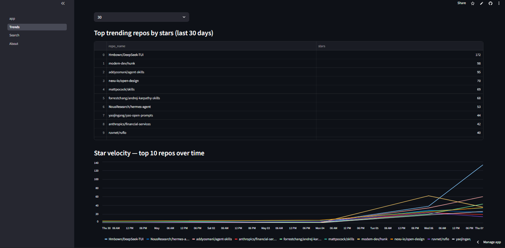

# 📊 ghtrends — Open Source Trends Intelligence Platform

[](https://github.com/abiralpokhrel-learns/ghtrends/actions/workflows/terraform-plan.yml)

> A serverless data platform on AWS that turns public GitHub activity into searchable, daily repository trends — with no always-on servers, and designed to stay within the AWS free tier.

**🌐 Live demo:** [ghtrends.streamlit.app](https://ghtrends.streamlit.app/)  
**📚 dbt project documentation:** [abiralpokhrel-learns.github.io/ghtrends](https://abiralpokhrel-learns.github.io/ghtrends/)

> **Note on cold start:** the app sleeps after 30 minutes of inactivity. The first request after sleep takes 30–60 seconds to wake up.



---

## ✨ What it does

`ghtrends` collects public GitHub events, models them into daily trend data, and makes the results easy to explore:

1. **Ingests** one hour of public GitHub events at a time from GH Archive, filtering to stars and pull requests.
2. **Stores** the events as partitioned Parquet files in Amazon S3 and catalogues them with AWS Glue.
3. **Transforms** the raw events with dbt-core into a daily mart, `fct_repo_trends_daily`.
4. **Embeds** descriptions for the top 500 trending repositories each week, for semantic search.
5. **Presents** trends and similar-repository search in a public Streamlit dashboard.

## 🧭 How it works

```text
GH Archive → EventBridge (hourly) → Lambda → S3 (partitioned Parquet)
  → Glue Catalog → Athena → dbt-core → fct_repo_trends_daily
  → Streamlit (Trends page)

Top 500 repos → sentence-transformers → NumPy vector index on S3
  → Streamlit (Search page)
```

In short: EventBridge fires the ingest Lambda every hour, a Glue Crawler registers new partitions daily, dbt-core runs nightly, and a weekly batch job refreshes the vector index.

## 🛠️ Tech stack

| Layer | Tool |
| --- | --- |
| Ingestion | AWS Lambda + EventBridge |
| Lake storage | Amazon S3, partitioned Parquet |
| Catalog | AWS Glue Crawler + Glue Catalog |
| Query engine | Amazon Athena |
| Transformation | dbt-core (Athena adapter) |
| Embeddings | sentence-transformers (`all-MiniLM-L6-v2`) |
| Vector search | NumPy in-memory cosine similarity |
| Vector storage | NumPy + Parquet on S3 |
| Dashboard | Streamlit on Streamlit Community Cloud |
| Infrastructure as code | Terraform, with an S3 + DynamoDB state backend |

## 📁 Project structure

| Path | What it contains |
| --- | --- |
| `bootstrap/` | One-time script for the Terraform state backend |
| `terraform/` | Infrastructure as code, including the `glue_catalog`, `lambda_ingest` and `s3_data_lake` modules and `envs/dev` |
| `lambda/ingest_gh_archive/` | Hourly GH Archive ingest function |
| `dbt/models/` | Staging, intermediate and mart models, including `fct_repo_trends_daily` |
| `embeddings/` | Offline NumPy vector-index builder and search test |
| `streamlit/` | Dashboard app, with Trends, Search and About pages |
| `analysis/` | Ad-hoc Athena SQL queries and findings charts |
| `.github/workflows/` | Terraform plan workflow for pull requests |
| `.devcontainer/` | Development container configuration |
| `Makefile` | Common project commands — run `make help` to list them |
| `PHASES.md` | Detailed 6-phase build plan |
| `PHASES_V1.md` | Original 10-phase build plan |
| `NEXT.md` | Ideas cut from v1 and considered for v2 |
| `.env.example` | Example environment variables - copy to `.env` and fill in your values |

## 🚀 Getting started

### Prerequisites

- Python 3.11+, Terraform 1.6+, AWS CLI v2, Docker (for Lambda packaging), Git and Make
- An AWS account
- A GitHub Personal Access Token (no scopes needed)

### Run it yourself

```bash
# Clone the repository
git clone https://github.com/abiralpokhrel-learns/ghtrends.git
cd ghtrends

# Copy the example environment file and fill in your values
cp .env.example .env

# One-time: create the Terraform state backend (S3 bucket + DynamoDB lock table)
make bootstrap

# Provision the infrastructure
make tf-init
make tf-apply

# Build the ingest Lambda package (requires Docker running)
make lambda-package

# Run the dbt models
make dbt-build

# Build the embeddings index for the top 500 trending repos
make embed-run

# Run the Streamlit dashboard locally
make streamlit-up
```

Run `make help` at any time to see all available targets, including `make dbt-test` and `make embed-test`.

## 🔍 What the data shows

Findings from the queries in `analysis/queries/`:

- **Top trending repository:** Hmbown/DeepSeek-TUI, with 172 stars over 3 days.
- **Fastest acceleration:** the same repository averaged 57.3 stars per day, with a single-day peak of 133.
- **Bots dominate activity:** Dependabot alone recorded 14,684 events across 7,079 unique repositories.
- **Stars are bimodal by UTC hour:** peaking at 00:00 UTC (2,410 stars) and again from 22:00 to 23:00 UTC.
- **Organisations differ in shape:** Microsoft recorded 332 events across 118 repositories, while Hmbown recorded 194 events for a single repository.

## 💡 Deliberate design choices

- **No vector database** — for around 500 vectors, NumPy in-memory search is simpler and needs no extra infrastructure.
- **No Iceberg** — plain Parquet partitioned by date is enough for append-only event data.
- **No EC2** — there is no always-on compute; hosting is on Streamlit Community Cloud and embeddings run weekly on a laptop.
- **No Step Functions** — EventBridge directly invoking Lambda handles hourly batch ingest at this scale.
- **No GitHub Actions for dbt yet** — dbt runs are manual for v1; automation is a v2 idea in `NEXT.md`.

## 💰 Cost

Designed to stay within the AWS free tier: **$0–1/month in months 1–12** and **~$1–2/month after the free tier**, based on the breakdown in the previous version of this README.

## 👤 Built by

Abiral Pokhrel — [GitHub](https://github.com/abiralpokhrel-learns) • [LinkedIn](https://www.linkedin.com/in/abiralpokhrel2005/)

## ⚖️ Licence

No LICENSE file is currently included in this repository.
